# İğneden Kâinata · Sahne planı

59 ayrı görsel planı; 58 konuşmalı sahne ve 1 sessiz kapanış. Hedef toplam yaklaşık 5 dakika 15 saniye. Her bir sahnenin üst sınırı 8 saniyedir. Sesler henüz üretilmedi; süreler okuyuş tahminidir.

Konuşma süreleri 4 hece/saniye + 0,35 saniye payla tahmin edilir. Gerçek kayıt hızı ve duraklarına bağlıdır; kayıt 8 saniyeyi aşarsa yeni sahneye bölünür, hızlandırılıp kesilmez. Görselin dosya süresi yoktur; Flow hedefi en fazla 8 saniyedir.

Metin kaynak sırasını korur. Uzun cümleler birden fazla plana bölünmüştür.

## 01 · Ali · 6.5 sn

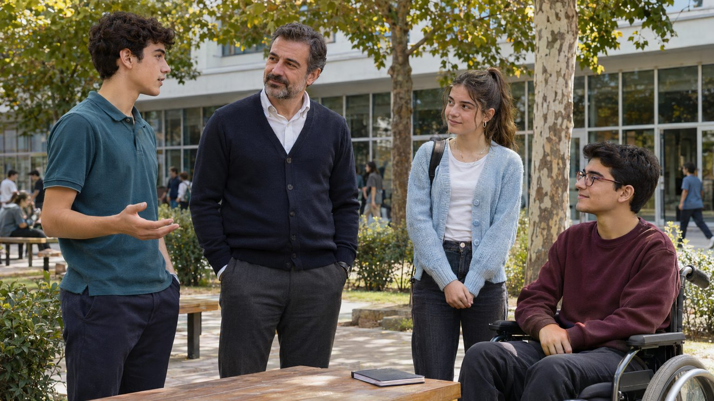

**Görsel:** Ali, iddiayı dile getirir; grup okul bahçesinde.

**Okutulacak metin:** Allah düşünce ürünüdür. Yani insanların uydurduğu bir şeydir.

**Okuyuş:** Bir iddiayı alıntılıyor; kişisel inancı hakkında hüküm kurulmaz.

**Arka plan:** Çok düşük düzeyde okul bahçesi ambiyansı; hafif yaprak hışırtısı ve uzaktan kuş sesi. Konuşmayı örtmesin.

## 02 · Ali · 4 sn

**Görsel:** Ali'nin düşünceli yakın planı.

**Okutulacak metin:** Aslında Allah diye bir şey yoktur.

**Okuyuş:** Bir iddiayı alıntılıyor; kişisel inancı hakkında hüküm kurulmaz.

**Arka plan:** Çok düşük düzeyde okul bahçesi ambiyansı; hafif yaprak hışırtısı ve uzaktan kuş sesi. Konuşmayı örtmesin.

## 03 · Murat Öğretmen · 5.0 sn

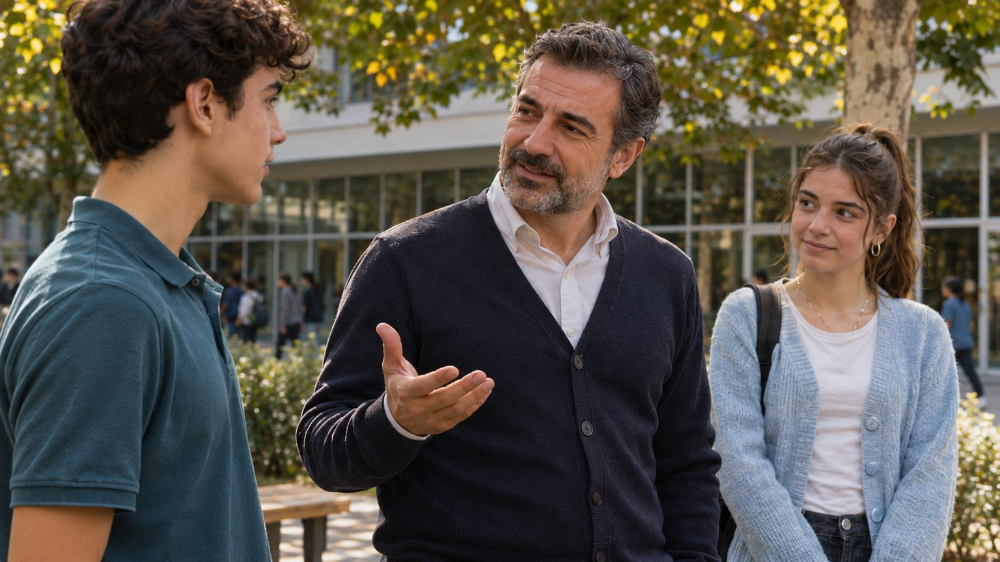

**Görsel:** Murat Öğretmen soruyu öğrencilere yöneltir.

**Okutulacak metin:** Düşünce ürünü şöyle mi oluyor? Bakıyoruz.

**Okuyuş:** Sakin, soru sorarak ilerleyen açıklama; benzetmeyi anlatıyor.

**Arka plan:** Çok düşük düzeyde okul bahçesi ambiyansı; hafif yaprak hışırtısı ve uzaktan kuş sesi. Konuşmayı örtmesin.

## 04 · Murat Öğretmen · 6.0 sn

**Görsel:** İğne ve iplik: masada güvenli bir yakın çekim.

**Okutulacak metin:** Bir iğnenin dahi mutlaka bir ustası, bir yapanı vardır.

**Okuyuş:** Sakin, soru sorarak ilerleyen açıklama; benzetmeyi anlatıyor. Ara planda aynı konuşmacının sesi kesilmeden, aynı tonda sürer.

**Arka plan:** Hafif bahçe ambiyansı; hareket varsa çok hafif kumaş hışırtısı. Abartılı metal efekti yok.

## 05 · Murat Öğretmen · 6.0 sn

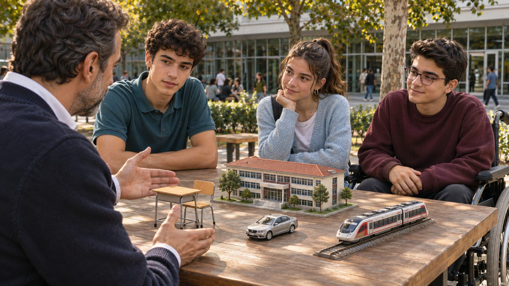

**Görsel:** Sıra, bina, araba ve tren modelleri.

**Okutulacak metin:** Masaların, sıraların, binaların, arabaların, trenlerin,

**Okuyuş:** Sakin, soru sorarak ilerleyen açıklama; benzetmeyi anlatıyor.

**Arka plan:** Çok düşük düzeyde okul bahçesi ambiyansı; hafif yaprak hışırtısı ve uzaktan kuş sesi. Konuşmayı örtmesin.

## 06 · Murat Öğretmen · 6.0 sn

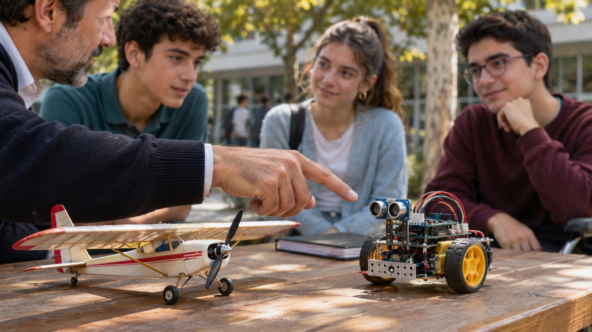

**Görsel:** Uçak ve eğitim robotu modelleri.

**Okutulacak metin:** uçakların, robotların mutlaka bir ustası, bir yapanı var.

**Okuyuş:** Sakin, soru sorarak ilerleyen açıklama; benzetmeyi anlatıyor. Ara planda aynı konuşmacının sesi kesilmeden, aynı tonda sürer.

**Arka plan:** Çok düşük düzeyde okul bahçesi ambiyansı; hafif yaprak hışırtısı ve uzaktan kuş sesi. Konuşmayı örtmesin.

## 07 · Murat Öğretmen · 5.5 sn

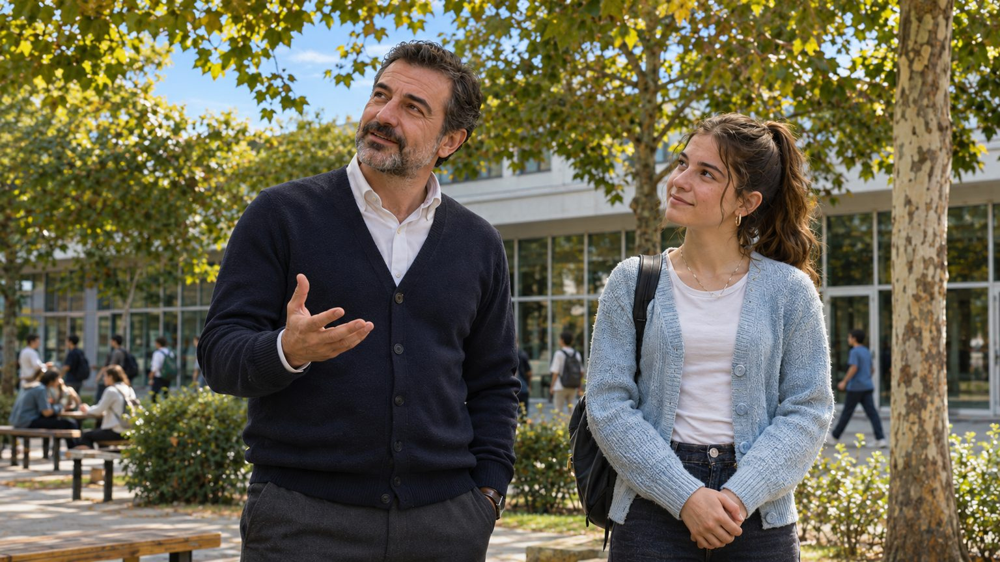

**Görsel:** Öğretmen ve Ece, ağaçlara ve gökyüzüne bakar.

**Okutulacak metin:** İnsan ve kainat bunlardan daha mükemmel varlıklardır.

**Okuyuş:** Sakin, soru sorarak ilerleyen açıklama; benzetmeyi anlatıyor.

**Arka plan:** Çok düşük düzeyde okul bahçesi ambiyansı; hafif yaprak hışırtısı ve uzaktan kuş sesi. Konuşmayı örtmesin.

## 08 · Murat Öğretmen · 7.0 sn

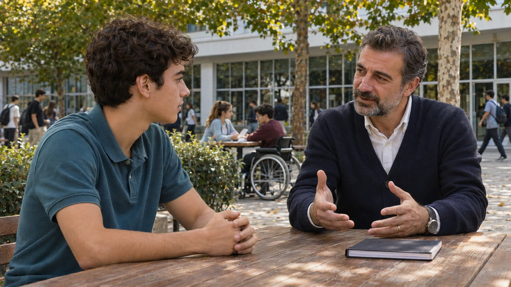

**Görsel:** Öğretmen ile Ali'nin karşılıklı konuşması.

**Okutulacak metin:** Dolayısıyla onların da bir ustası, bir yapanı, bir yaratanı vardır.

**Okuyuş:** Sakin, soru sorarak ilerleyen açıklama; benzetmeyi anlatıyor.

**Arka plan:** Çok düşük düzeyde okul bahçesi ambiyansı; hafif yaprak hışırtısı ve uzaktan kuş sesi. Konuşmayı örtmesin.

## 09 · Murat Öğretmen · 7.0 sn

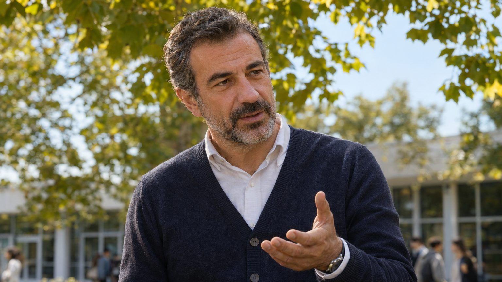

**Görsel:** Öğretmenin sakin açıklaması, yakın plan.

**Okutulacak metin:** O da Allah'tır. Allah'ın düşünce ürünü olması bu şekilde mi oluyor?

**Okuyuş:** Sakin, soru sorarak ilerleyen açıklama; benzetmeyi anlatıyor.

**Arka plan:** Çok düşük düzeyde okul bahçesi ambiyansı; hafif yaprak hışırtısı ve uzaktan kuş sesi. Konuşmayı örtmesin.

## 10 · Ece · 5.0 sn

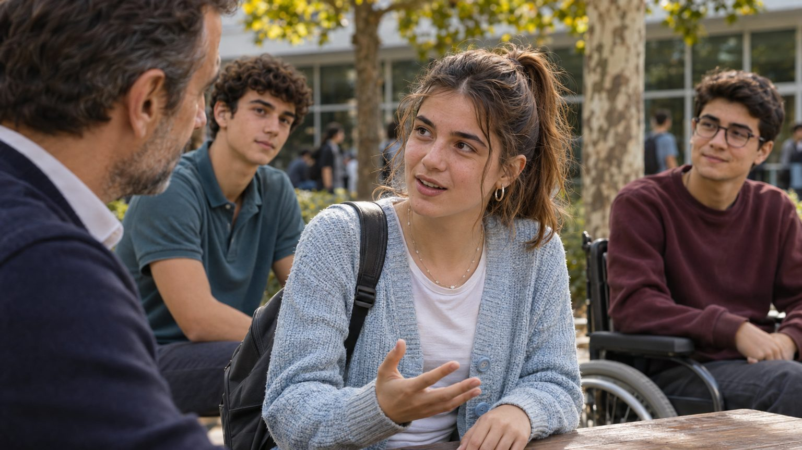

**Görsel:** Ece'nin meraklı yanıtı.

**Okutulacak metin:** Evet. Ancak aksini iddia edenler de var.

**Okuyuş:** Karşı görüşler bulunduğunu belirtiyor; meraklı ve saygılı.

**Arka plan:** Çok düşük düzeyde okul bahçesi ambiyansı; hafif yaprak hışırtısı ve uzaktan kuş sesi. Konuşmayı örtmesin.

## 11 · Murat Öğretmen · 4 sn

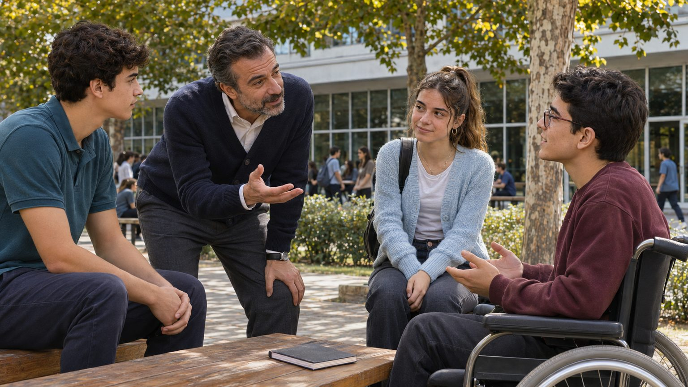

**Görsel:** Öğretmen gruba yeni bir soru sorar.

**Okutulacak metin:** Aksi ne şekilde iddia edilir?

**Okuyuş:** Kaynak metindeki karşı iddiayı alıntılıyor ve değerlendirmesini aktarıyor.

**Arka plan:** Çok düşük düzeyde okul bahçesi ambiyansı; hafif yaprak hışırtısı ve uzaktan kuş sesi. Konuşmayı örtmesin.

## 12 · Murat Öğretmen · 5.5 sn

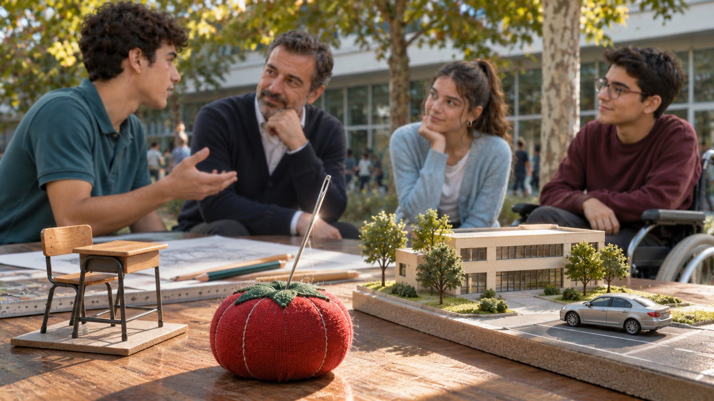

**Görsel:** İğne ve gündelik nesne modelleri, masa çekimi.

**Okutulacak metin:** İğneler, sıralar, masalar, binalar, arabalar, trenler,

**Okuyuş:** Kaynak metindeki karşı iddiayı alıntılıyor ve değerlendirmesini aktarıyor. Ara planda aynı konuşmacının sesi kesilmeden, aynı tonda sürer.

**Arka plan:** Hafif bahçe ambiyansı; hareket varsa çok hafif kumaş hışırtısı. Abartılı metal efekti yok.

## 13 · Murat Öğretmen · 5.0 sn

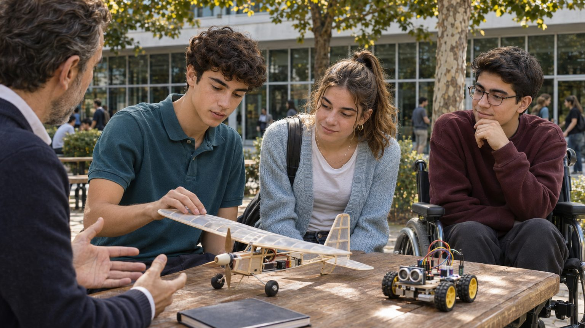

**Görsel:** Ali ve Ece, uçak ile robot modelini inceler.

**Okutulacak metin:** uçaklar, robotlar kendi kendine meydana gelmiştir.

**Okuyuş:** Kaynak metindeki karşı iddiayı alıntılıyor ve değerlendirmesini aktarıyor.

**Arka plan:** Çok düşük düzeyde okul bahçesi ambiyansı; hafif yaprak hışırtısı ve uzaktan kuş sesi. Konuşmayı örtmesin.

## 14 · Murat Öğretmen · 4 sn

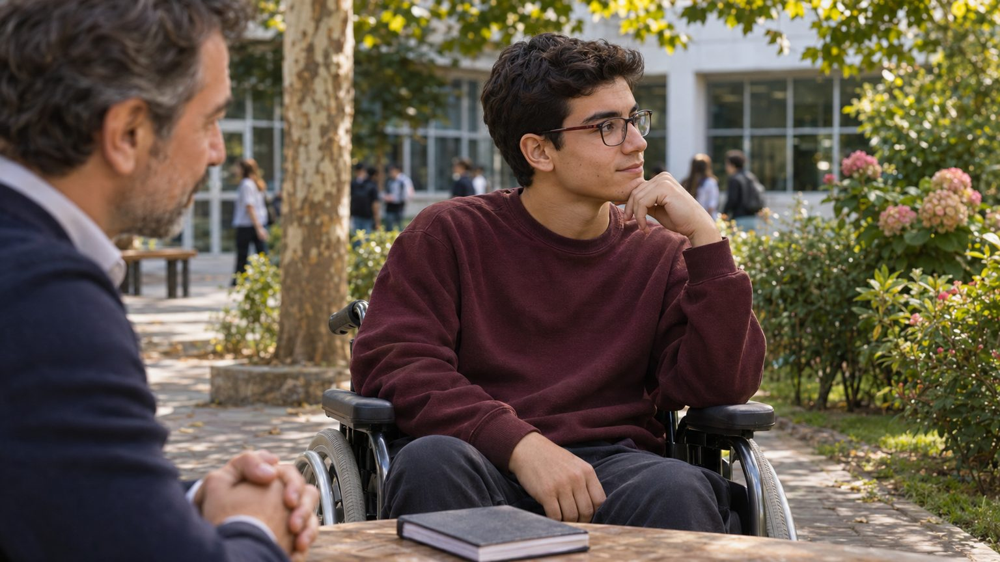

**Görsel:** Deniz'in düşünceli dinleyişi.

**Okutulacak metin:** Dolayısıyla insan ve kainat da

**Okuyuş:** Kaynak metindeki karşı iddiayı alıntılıyor ve değerlendirmesini aktarıyor.

**Arka plan:** Çok düşük düzeyde okul bahçesi ambiyansı; hafif yaprak hışırtısı ve uzaktan kuş sesi. Konuşmayı örtmesin.

## 15 · Murat Öğretmen · 5.0 sn

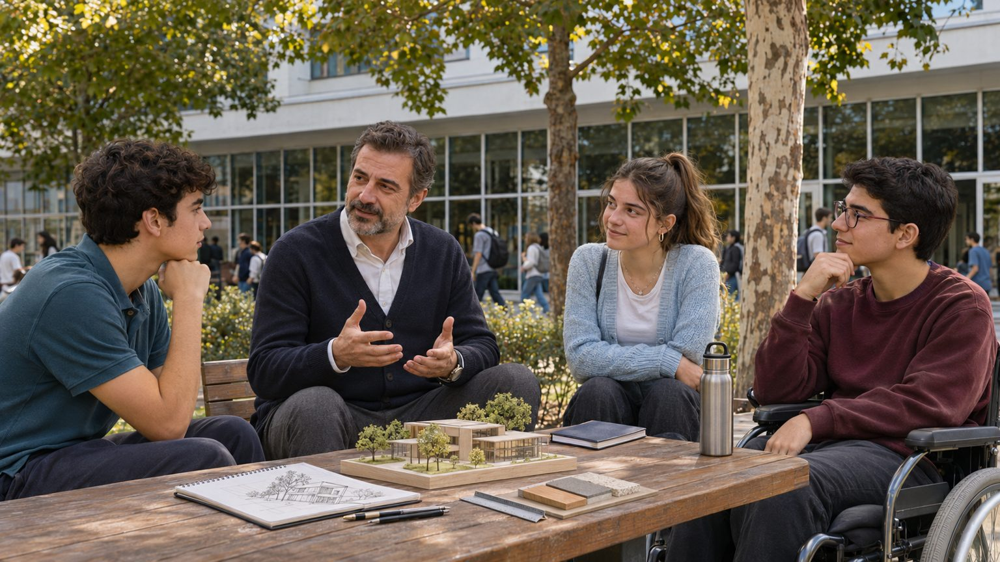

**Görsel:** Öğretmenin açıklaması, masa ve modeller.

**Okutulacak metin:** kendi kendine meydana gelmiştir diyebilirsiniz.

**Okuyuş:** Kaynak metindeki karşı iddiayı alıntılıyor ve değerlendirmesini aktarıyor.

**Arka plan:** Çok düşük düzeyde okul bahçesi ambiyansı; hafif yaprak hışırtısı ve uzaktan kuş sesi. Konuşmayı örtmesin.

## 16 · Murat Öğretmen · 6.5 sn

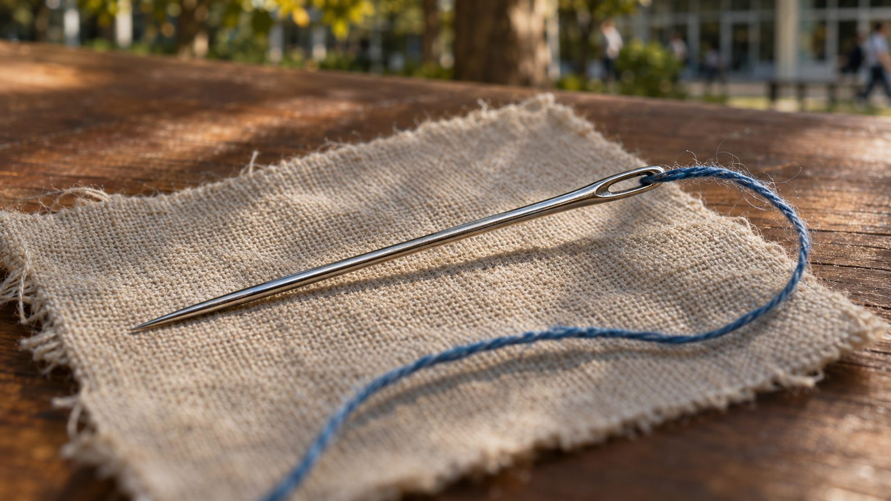

**Görsel:** Kumaş üzerinde iğne ve mavi iplik, makro çekim.

**Okutulacak metin:** Ancak basit bir iğnenin dahi kendi kendine meydana geldiğini

**Okuyuş:** Kaynak metindeki karşı iddiayı alıntılıyor ve değerlendirmesini aktarıyor. Ara planda aynı konuşmacının sesi kesilmeden, aynı tonda sürer.

**Arka plan:** Hafif bahçe ambiyansı; hareket varsa çok hafif kumaş hışırtısı. Abartılı metal efekti yok.

## 17 · Murat Öğretmen · 6.0 sn

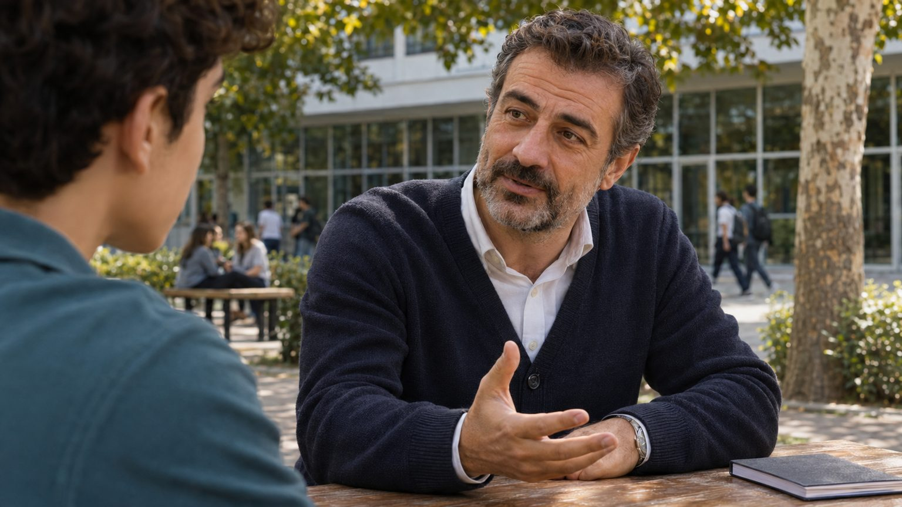

**Görsel:** Öğretmenin açıklaması, yakın plan.

**Okutulacak metin:** iddia edebilmemiz için aklımızı kaybetmemiz lazım.

**Okuyuş:** Kaynak metindeki karşı iddiayı alıntılıyor ve değerlendirmesini aktarıyor.

**Arka plan:** Çok düşük düzeyde okul bahçesi ambiyansı; hafif yaprak hışırtısı ve uzaktan kuş sesi. Konuşmayı örtmesin.

## 18 · Murat Öğretmen · 6.0 sn

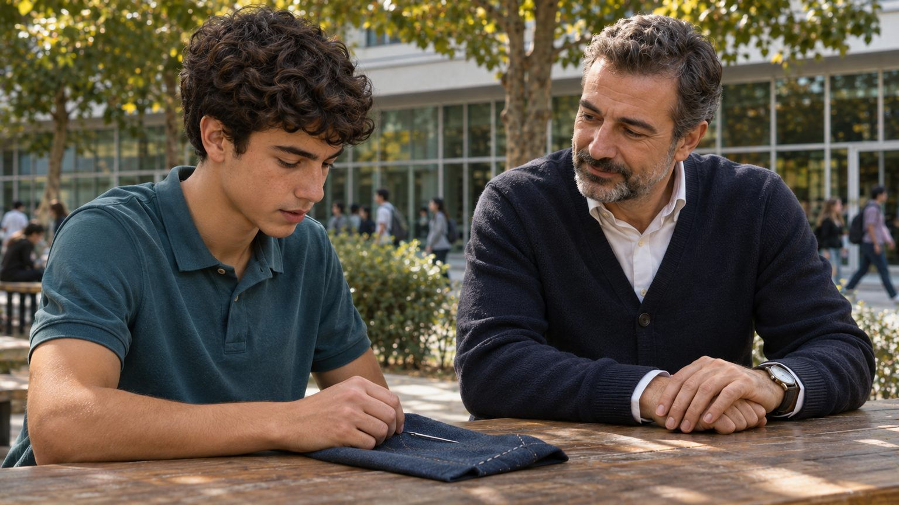

**Görsel:** Ali ile öğretmen, iğne örneğini inceler.

**Okutulacak metin:** Yoksa aklı başında olan hiçbir insan bir iğnenin dahi

**Okuyuş:** Kaynak metindeki karşı iddiayı alıntılıyor ve değerlendirmesini aktarıyor.

**Arka plan:** Hafif bahçe ambiyansı; hareket varsa çok hafif kumaş hışırtısı. Abartılı metal efekti yok.

## 19 · Murat Öğretmen · 5.5 sn

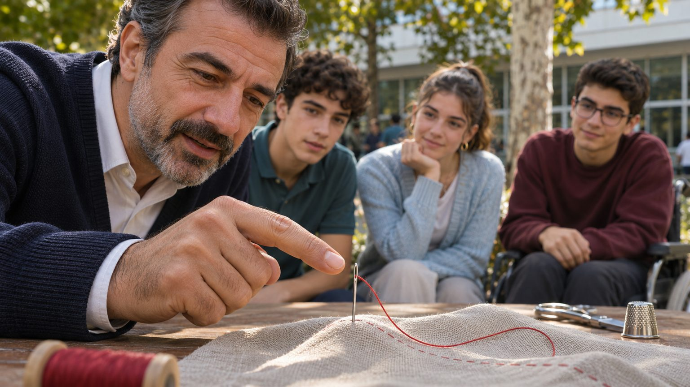

**Görsel:** Öğretmen, masadaki iğneyi işaret eder.

**Okutulacak metin:** kendi kendine meydana geldiğini iddia edemez.

**Okuyuş:** Kaynak metindeki karşı iddiayı alıntılıyor ve değerlendirmesini aktarıyor. Ara planda aynı konuşmacının sesi kesilmeden, aynı tonda sürer.

**Arka plan:** Hafif bahçe ambiyansı; hareket varsa çok hafif kumaş hışırtısı. Abartılı metal efekti yok.

## 20 · Murat Öğretmen · 7.0 sn

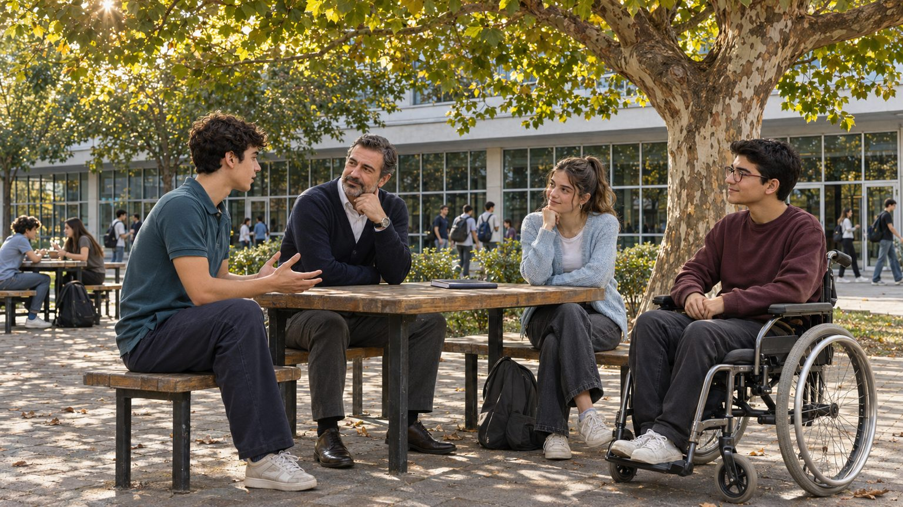

**Görsel:** Ağaçların altında grubun geniş planı.

**Okutulacak metin:** Dolayısıyla aklı başında olan hiçbir insan böyle mükemmel kainatı

**Okuyuş:** Kaynak metindeki karşı iddiayı alıntılıyor ve değerlendirmesini aktarıyor.

**Arka plan:** Çok düşük düzeyde okul bahçesi ambiyansı; hafif yaprak hışırtısı ve uzaktan kuş sesi. Konuşmayı örtmesin.

## 21 · Murat Öğretmen · 6.0 sn

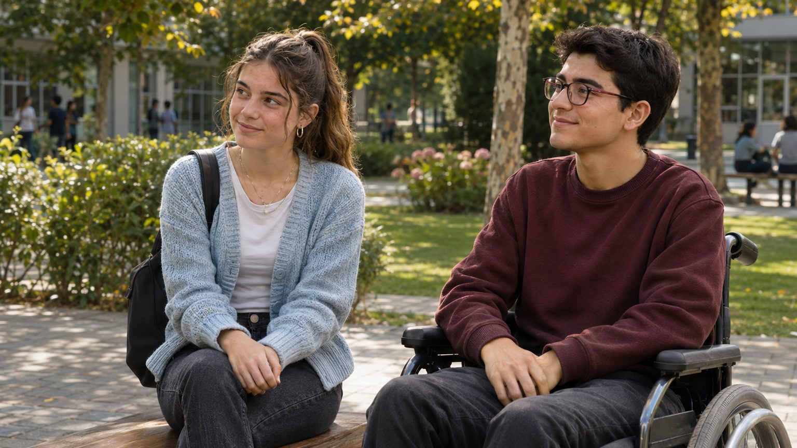

**Görsel:** Ece ve Deniz'in dinlediği ikili plan.

**Okutulacak metin:** ve içindeki en mükemmel varlık olan insanı ve hayvanları,

**Okuyuş:** Kaynak metindeki karşı iddiayı alıntılıyor ve değerlendirmesini aktarıyor.

**Arka plan:** Çok düşük düzeyde okul bahçesi ambiyansı; hafif yaprak hışırtısı ve uzaktan kuş sesi. Konuşmayı örtmesin.

## 22 · Murat Öğretmen · 6.5 sn

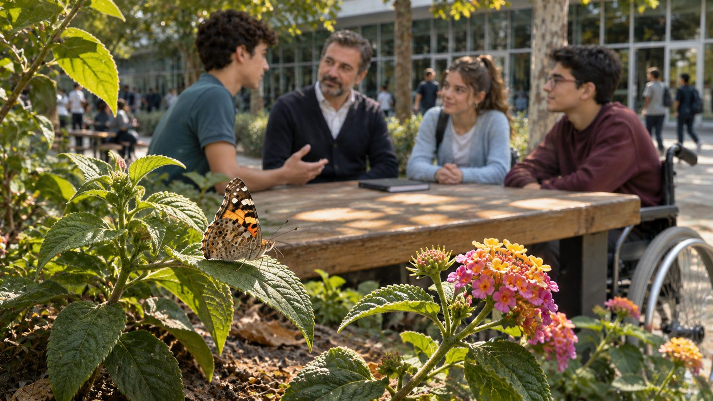

**Görsel:** Bitki, çiçek ve yaprak üzerindeki kelebek.

**Okutulacak metin:** bitkileri kendi kendine meydana geldiğini iddia edemez.

**Okuyuş:** Kaynak metindeki karşı iddiayı alıntılıyor ve değerlendirmesini aktarıyor. Ara planda aynı konuşmacının sesi kesilmeden, aynı tonda sürer.

**Arka plan:** Hafif bahçe rüzgârı, yaprak hışırtısı ve uzaktan kuşlar. Konuşmayı örtmesin.

## 23 · Deniz · 6.0 sn

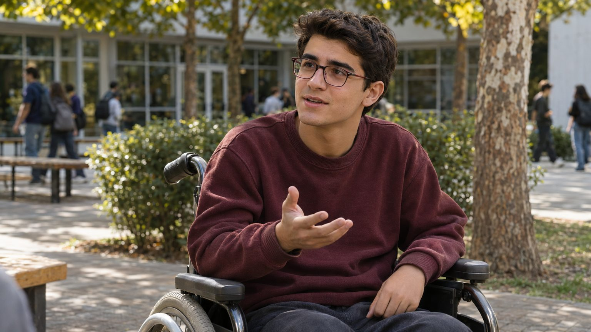

**Görsel:** Deniz sorusunu yöneltir.

**Okutulacak metin:** Öyleyse her şeyi Allah yarattıysa Allah'ı kim yarattı?

**Okuyuş:** Öğrenmek isteyen, içten ve açık bir soru.

**Arka plan:** Çok düşük düzeyde okul bahçesi ambiyansı; hafif yaprak hışırtısı ve uzaktan kuş sesi. Konuşmayı örtmesin.

## 24 · Murat Öğretmen · 5.0 sn

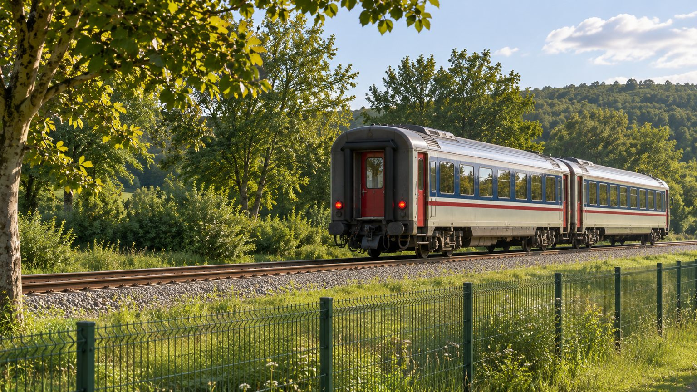

**Görsel:** Yolcu treninin son vagonları.

**Okutulacak metin:** Bir trende en son vagonu bir öndeki çekmekte.

**Okuyuş:** Tren benzetmesini adım adım anlatıyor. Ara planda aynı konuşmacının sesi kesilmeden, aynı tonda sürer.

**Arka plan:** Çok düşük tren tekerleği ve ray ritmi; hafif dış ortam rüzgârı. Korna yok; konuşmayı örtmesin.

## 25 · Murat Öğretmen · 4 sn

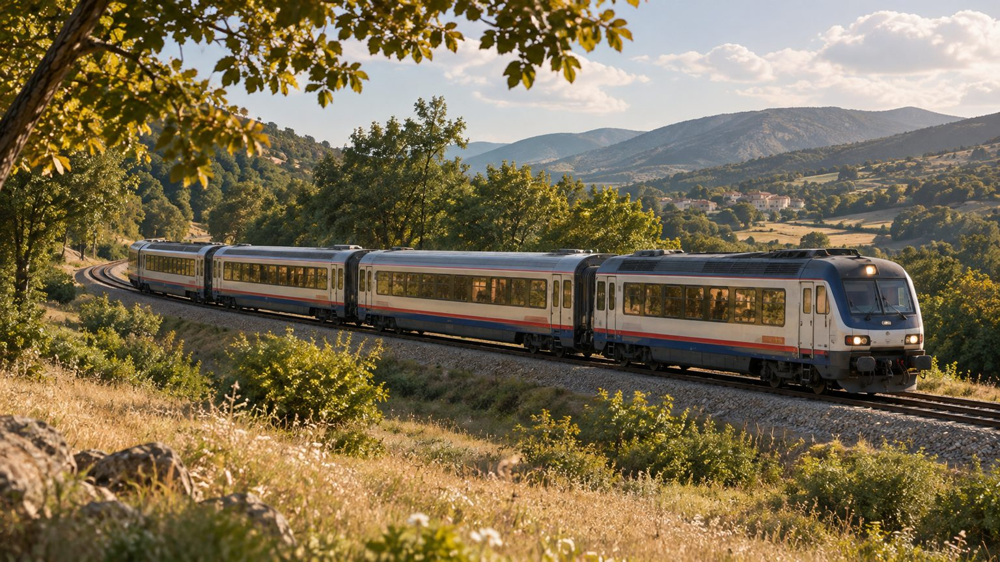

**Görsel:** Birbirine bağlanan vagonlar.

**Okutulacak metin:** Onu bir öndeki, onu bir öndeki.

**Okuyuş:** Tren benzetmesini adım adım anlatıyor. Ara planda aynı konuşmacının sesi kesilmeden, aynı tonda sürer.

**Arka plan:** Çok düşük tren tekerleği ve ray ritmi; hafif dış ortam rüzgârı. Korna yok; konuşmayı örtmesin.

## 26 · Murat Öğretmen · 4 sn

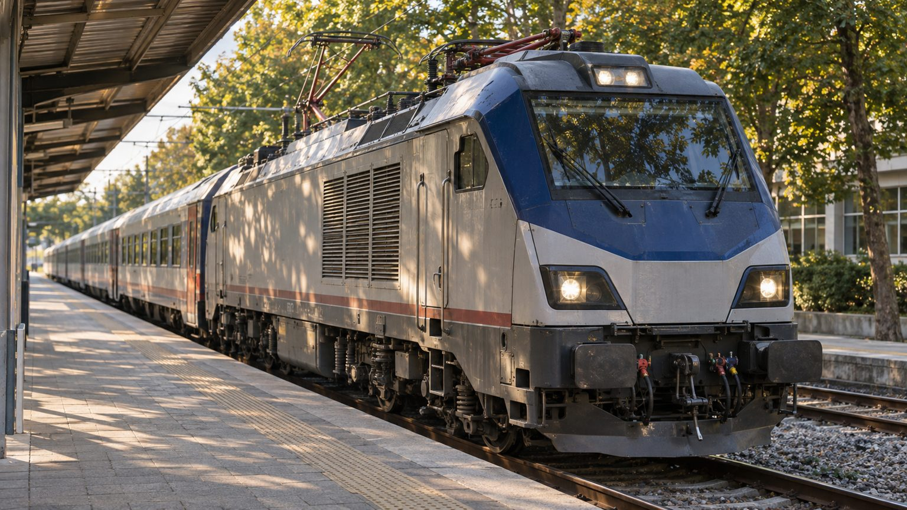

**Görsel:** Lokomotifin önden üç çeyrek görünümü.

**Okutulacak metin:** İş lokomotife dayandığında

**Okuyuş:** Tren benzetmesini adım adım anlatıyor. Ara planda aynı konuşmacının sesi kesilmeden, aynı tonda sürer.

**Arka plan:** Düşük istasyon ambiyansı ve uzaktan tren uğultusu. Anons veya korna yok.

## 27 · Murat Öğretmen · 5.5 sn

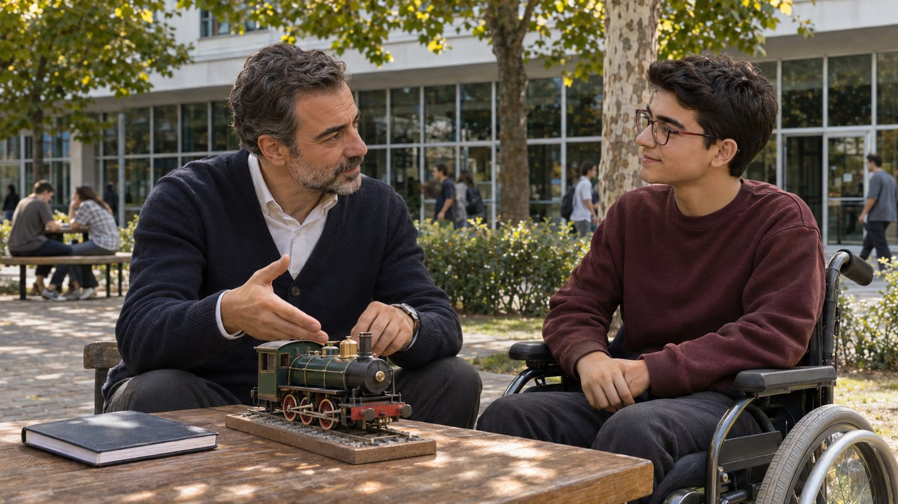

**Görsel:** Öğretmen, Deniz'e tren modeliyle açıklama yapar.

**Okutulacak metin:** lokomotifi kim çekiyor diye bir soru sorulamaz.

**Okuyuş:** Tren benzetmesini adım adım anlatıyor.

**Arka plan:** Çok düşük düzeyde okul bahçesi ambiyansı; hafif yaprak hışırtısı ve uzaktan kuş sesi. Konuşmayı örtmesin.

## 28 · Murat Öğretmen · 4 sn

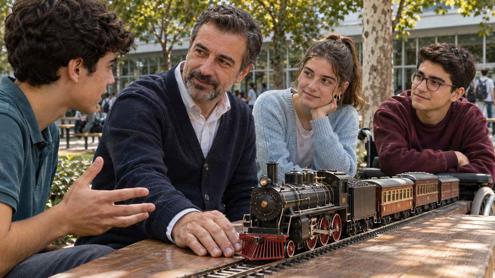

**Görsel:** Masa üzerinde lokomotif ve bağlı vagonlar.

**Okutulacak metin:** Çünkü lokomotif denince akla çeken

**Okuyuş:** Tren benzetmesini adım adım anlatıyor. Ara planda aynı konuşmacının sesi kesilmeden, aynı tonda sürer.

**Arka plan:** Çok düşük düzeyde okul bahçesi ambiyansı; hafif yaprak hışırtısı ve uzaktan kuş sesi. Konuşmayı örtmesin.

## 29 · Murat Öğretmen · 5.0 sn

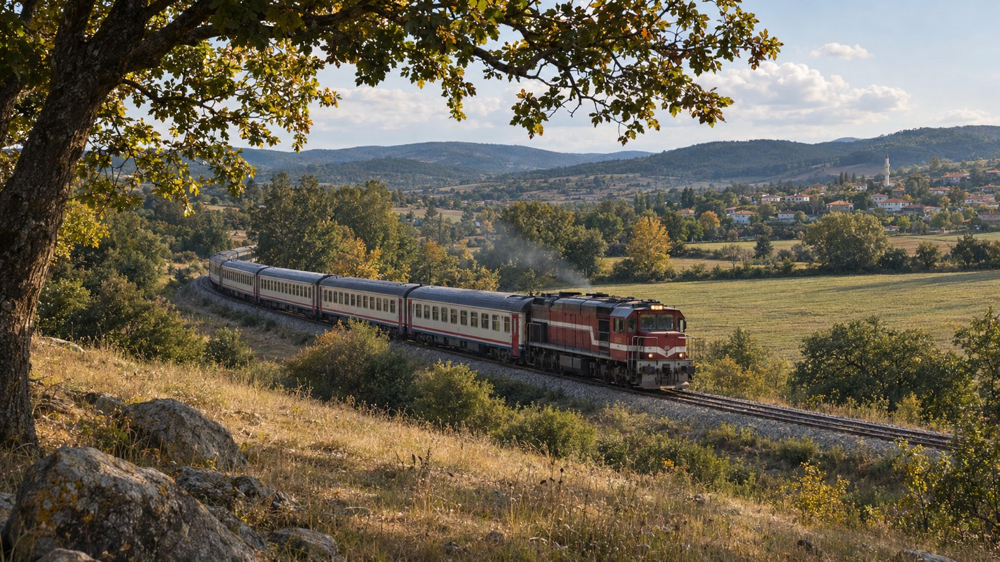

**Görsel:** Kırsalda ilerleyen tren, uzaktan çekim.

**Okutulacak metin:** fakat kendisi çekilmeyen bir makine gelir.

**Okuyuş:** Tren benzetmesini adım adım anlatıyor. Ara planda aynı konuşmacının sesi kesilmeden, aynı tonda sürer.

**Arka plan:** Çok düşük tren tekerleği ve ray ritmi; hafif dış ortam rüzgârı. Korna yok; konuşmayı örtmesin.

## 30 · Ece · 4 sn

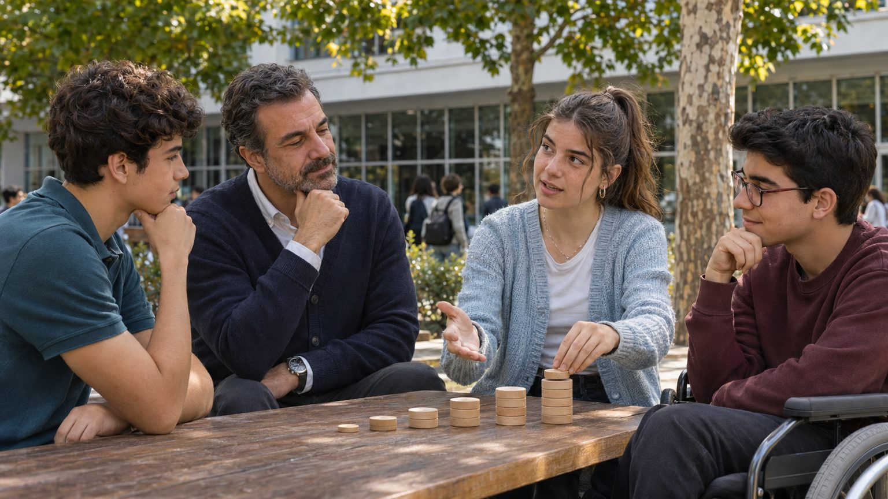

**Görsel:** Ece, sıralı ahşap parçalarla benzetmeyi anlatır.

**Okutulacak metin:** Askerde bir er emri onbaşıdan alır.

**Okuyuş:** Kaynak metindeki emir zinciri benzetmesini aktarıyor.

**Arka plan:** Hafif bahçe ambiyansı; yalnızca bir parça masaya değerse yumuşak ahşap tıkırtısı. Konuşmayı örtmesin.

## 31 · Ece · 7.0 sn

**Görsel:** Farklı boylardaki simgesiz ahşap parçalar.

**Okutulacak metin:** Onbaşı çavuştan, çavuş üstçavuştan, iş cumhurbaşkanına kadar uzar.

**Okuyuş:** Kaynak metindeki emir zinciri benzetmesini aktarıyor. Ara planda aynı konuşmacının sesi kesilmeden, aynı tonda sürer.

**Arka plan:** Hafif bahçe ambiyansı; yalnızca bir parça masaya değerse yumuşak ahşap tıkırtısı. Konuşmayı örtmesin.

## 32 · Ece · 6.5 sn

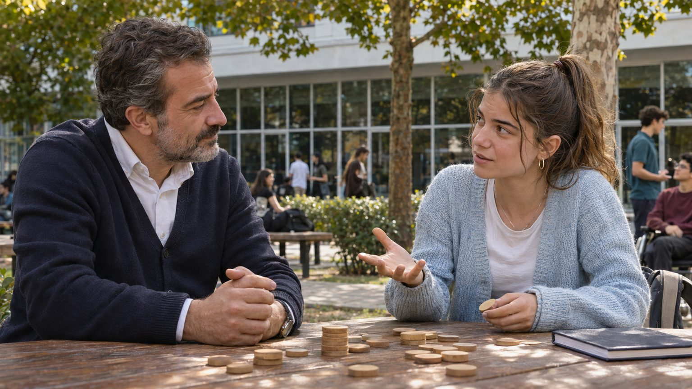

**Görsel:** Ece, öğretmene bakarak sorar.

**Okutulacak metin:** Ancak cumhurbaşkanı emri kimden alır diye bir soru sorulamaz.

**Okuyuş:** Kaynak metindeki emir zinciri benzetmesini aktarıyor.

**Arka plan:** Çok düşük düzeyde okul bahçesi ambiyansı; hafif yaprak hışırtısı ve uzaktan kuş sesi. Konuşmayı örtmesin.

## 33 · Ece · 5.0 sn

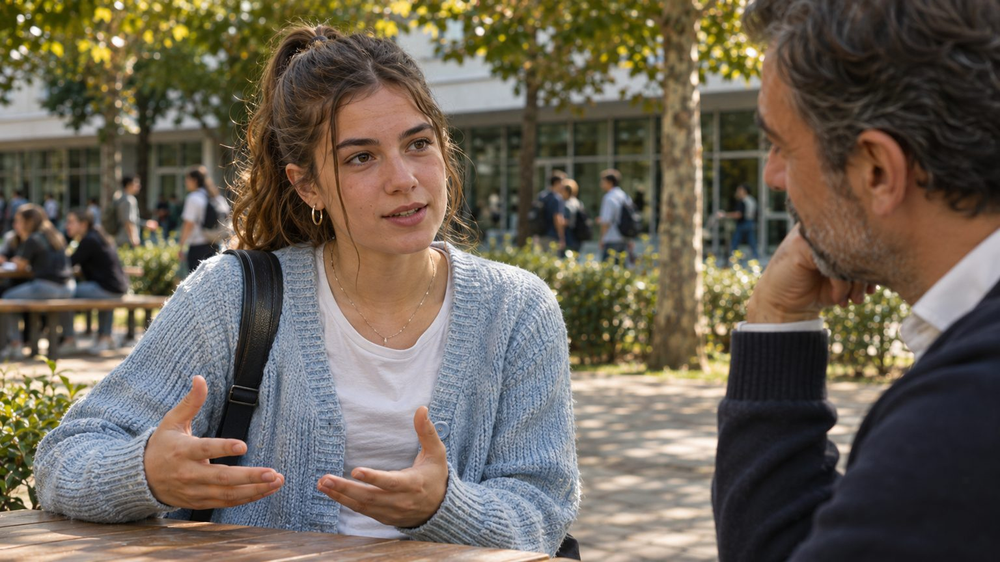

**Görsel:** Ece'nin açıklaması, yakın plan.

**Okutulacak metin:** Çünkü cumhurbaşkanı denince akla emir veren

**Okuyuş:** Kaynak metindeki emir zinciri benzetmesini aktarıyor.

**Arka plan:** Çok düşük düzeyde okul bahçesi ambiyansı; hafif yaprak hışırtısı ve uzaktan kuş sesi. Konuşmayı örtmesin.

## 34 · Ece · 4.5 sn

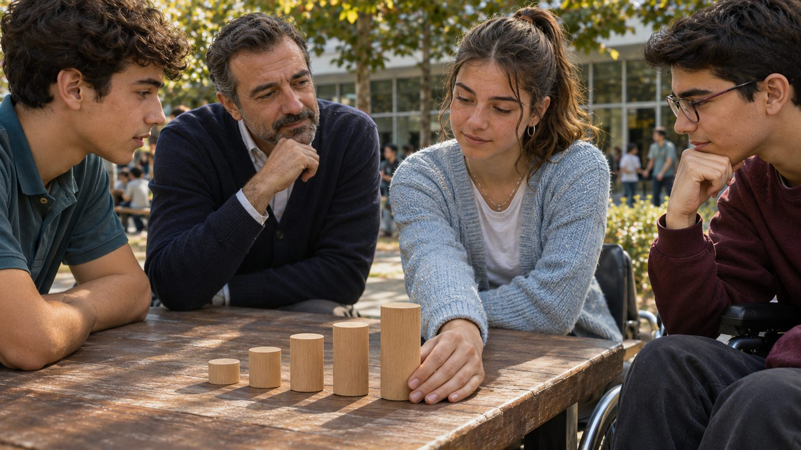

**Görsel:** Dizinin sonundaki büyük ahşap parça.

**Okutulacak metin:** fakat kendisi emir almayan bir zat gelir.

**Okuyuş:** Kaynak metindeki emir zinciri benzetmesini aktarıyor. Ara planda aynı konuşmacının sesi kesilmeden, aynı tonda sürer.

**Arka plan:** Hafif bahçe ambiyansı; yalnızca bir parça masaya değerse yumuşak ahşap tıkırtısı. Konuşmayı örtmesin.

## 35 · Murat Öğretmen · 4 sn

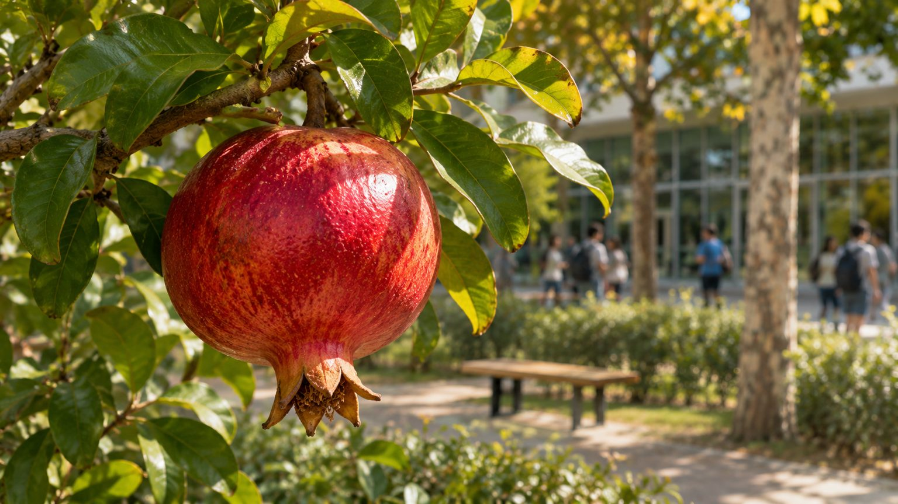

**Görsel:** Dalında nar, yakın çekim.

**Okutulacak metin:** Bir nar ağacında yapılır.

**Okuyuş:** Nar ve fabrika benzetmesiyle kaynak görüşü açıklıyor. Ara planda aynı konuşmacının sesi kesilmeden, aynı tonda sürer.

**Arka plan:** Hafif bahçe rüzgârı, yaprak hışırtısı ve uzaktan kuşlar. Konuşmayı örtmesin.

## 36 · Murat Öğretmen · 4 sn

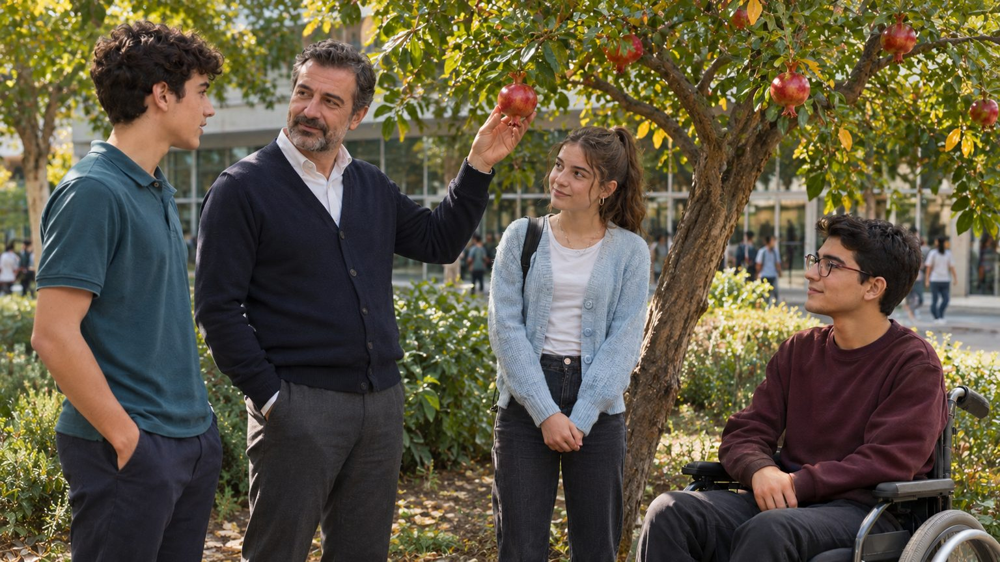

**Görsel:** Bahçede bir nar ağacı.

**Okutulacak metin:** Nar ağacı kainat fabrikasında

**Okuyuş:** Nar ve fabrika benzetmesiyle kaynak görüşü açıklıyor. Ara planda aynı konuşmacının sesi kesilmeden, aynı tonda sürer.

**Arka plan:** Hafif bahçe rüzgârı, yaprak hışırtısı ve uzaktan kuşlar. Konuşmayı örtmesin.

## 37 · Murat Öğretmen · 5.0 sn

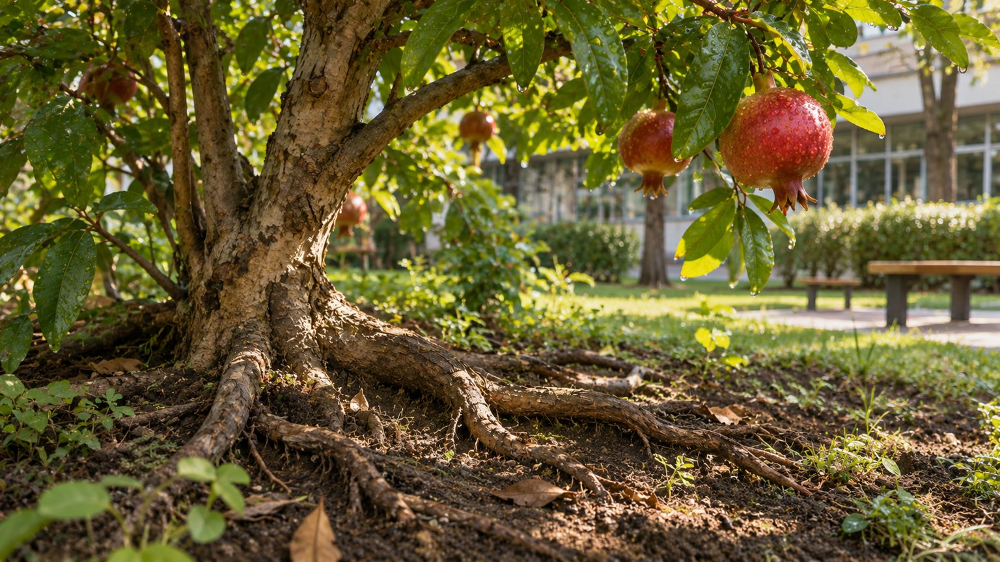

**Görsel:** Toprak, yapraklar, su damlaları ve güneş ışığı.

**Okutulacak metin:** hava, su, güneşten oluşan bir fabrikada yapılır.

**Okuyuş:** Nar ve fabrika benzetmesiyle kaynak görüşü açıklıyor. Ara planda aynı konuşmacının sesi kesilmeden, aynı tonda sürer.

**Arka plan:** Hafif bahçe rüzgârı, yaprak hışırtısı ve uzaktan kuşlar. Konuşmayı örtmesin.

## 38 · Murat Öğretmen · 5.0 sn

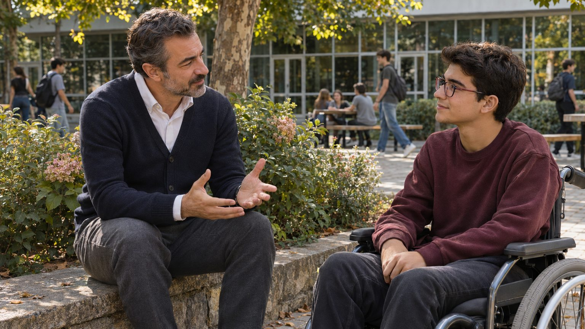

**Görsel:** Öğretmen ve Deniz, bahçe kenarında konuşur.

**Okutulacak metin:** Kainat fabrikası Allah'a dayandırılmazsa

**Okuyuş:** Nar ve fabrika benzetmesiyle kaynak görüşü açıklıyor.

**Arka plan:** Çok düşük düzeyde okul bahçesi ambiyansı; hafif yaprak hışırtısı ve uzaktan kuş sesi. Konuşmayı örtmesin.

## 39 · Murat Öğretmen · 5.5 sn

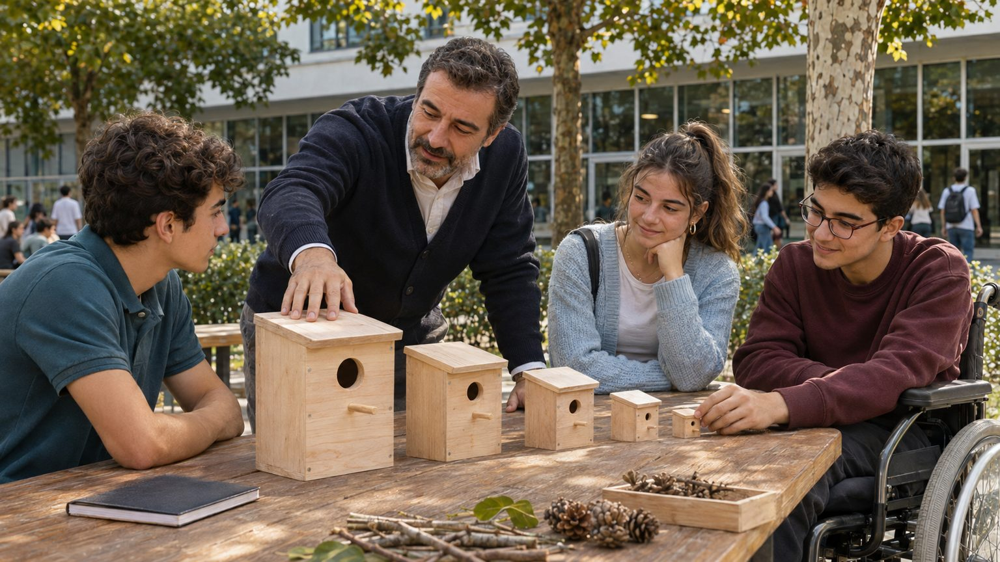

**Görsel:** Farklı boyutlardaki ahşap kutularla sıra benzetmesi.

**Okutulacak metin:** ona da başka bir fabrika, ona da başka bir fabrika,

**Okuyuş:** Nar ve fabrika benzetmesiyle kaynak görüşü açıklıyor. Ara planda aynı konuşmacının sesi kesilmeden, aynı tonda sürer.

**Arka plan:** Hafif bahçe ambiyansı; yalnızca bir parça masaya değerse yumuşak ahşap tıkırtısı. Konuşmayı örtmesin.

## 40 · Murat Öğretmen · 6.0 sn

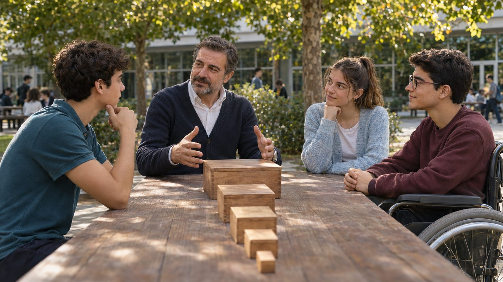

**Görsel:** Perspektifte devam eden ahşap kutular.

**Okutulacak metin:** ona da başka bir fabrika iş sonsuza kadar uzar gider.

**Okuyuş:** Nar ve fabrika benzetmesiyle kaynak görüşü açıklıyor. Ara planda aynı konuşmacının sesi kesilmeden, aynı tonda sürer.

**Arka plan:** Hafif bahçe ambiyansı; yalnızca bir parça masaya değerse yumuşak ahşap tıkırtısı. Konuşmayı örtmesin.

## 41 · Murat Öğretmen · 4 sn

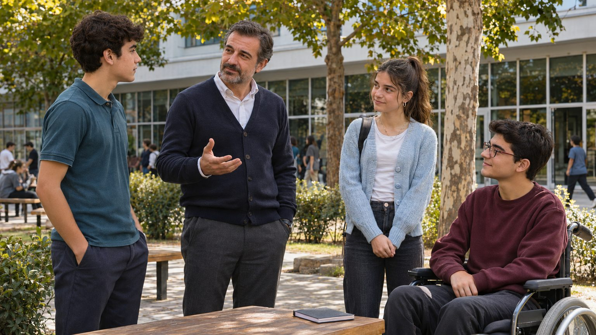

**Görsel:** Öğretmen açıklamasını tamamlar.

**Okutulacak metin:** Böyle bir şeyin olması da mümkün değil.

**Okuyuş:** Nar ve fabrika benzetmesiyle kaynak görüşü açıklıyor.

**Arka plan:** Çok düşük düzeyde okul bahçesi ambiyansı; hafif yaprak hışırtısı ve uzaktan kuş sesi. Konuşmayı örtmesin.

## 42 · Murat Öğretmen · 5.0 sn

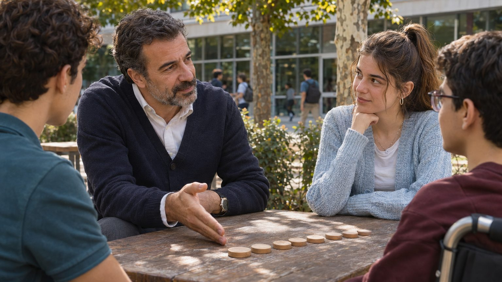

**Görsel:** Ahşap parçalarla benzetmeye dönüş.

**Okutulacak metin:** Nasıl ki cumhurbaşkanı denince akla emir veren

**Okuyuş:** Nar ve fabrika benzetmesiyle kaynak görüşü açıklıyor.

**Arka plan:** Hafif bahçe ambiyansı; yalnızca bir parça masaya değerse yumuşak ahşap tıkırtısı. Konuşmayı örtmesin.

## 43 · Murat Öğretmen · 5.0 sn

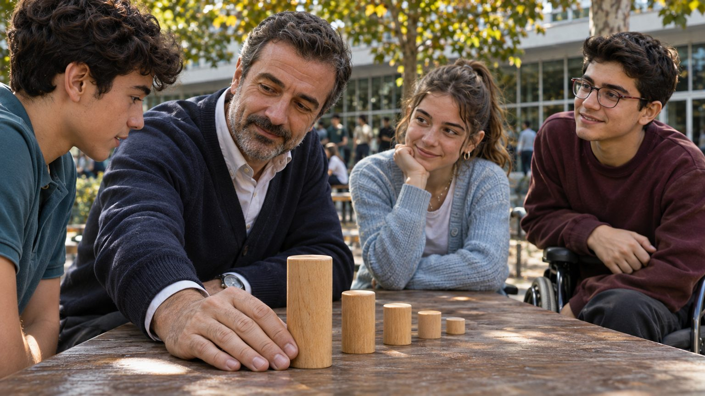

**Görsel:** Büyük ahşap parça ve arkasındaki dizi.

**Okutulacak metin:** fakat kendisi emir almayan bir zat geliyorsa,

**Okuyuş:** Nar ve fabrika benzetmesiyle kaynak görüşü açıklıyor. Ara planda aynı konuşmacının sesi kesilmeden, aynı tonda sürer.

**Arka plan:** Hafif bahçe ambiyansı; yalnızca bir parça masaya değerse yumuşak ahşap tıkırtısı. Konuşmayı örtmesin.

## 44 · Murat Öğretmen · 4 sn

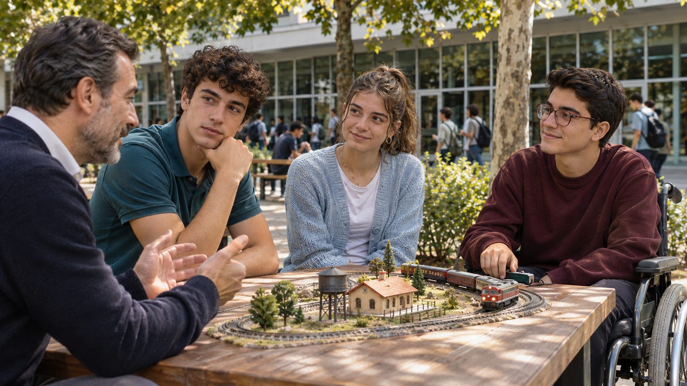

**Görsel:** Ali ve masadaki tren modeli.

**Okutulacak metin:** lokomotif denince akla çeken

**Okuyuş:** Nar ve fabrika benzetmesiyle kaynak görüşü açıklıyor. Ara planda aynı konuşmacının sesi kesilmeden, aynı tonda sürer.

**Arka plan:** Çok düşük düzeyde okul bahçesi ambiyansı; hafif yaprak hışırtısı ve uzaktan kuş sesi. Konuşmayı örtmesin.

## 45 · Murat Öğretmen · 5.0 sn

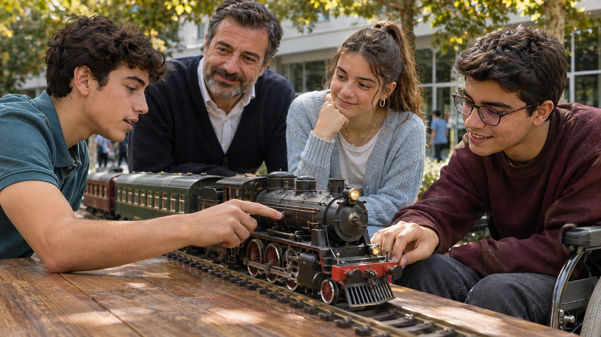

**Görsel:** Lokomotif modeli, yakın çekim.

**Okutulacak metin:** fakat kendisi çekilmeyen bir makine geliyorsa,

**Okuyuş:** Nar ve fabrika benzetmesiyle kaynak görüşü açıklıyor. Ara planda aynı konuşmacının sesi kesilmeden, aynı tonda sürer.

**Arka plan:** Çok düşük düzeyde okul bahçesi ambiyansı; hafif yaprak hışırtısı ve uzaktan kuş sesi. Konuşmayı örtmesin.

## 46 · Murat Öğretmen · 4 sn

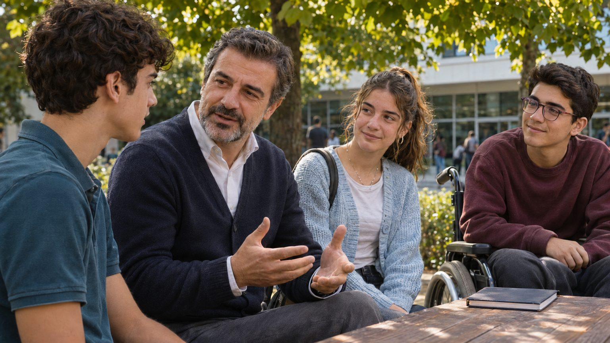

**Görsel:** Öğretmenin sakin anlatımı, yakın plan.

**Okutulacak metin:** Allah denince de akla yaratan

**Okuyuş:** Nar ve fabrika benzetmesiyle kaynak görüşü açıklıyor.

**Arka plan:** Çok düşük düzeyde okul bahçesi ambiyansı; hafif yaprak hışırtısı ve uzaktan kuş sesi. Konuşmayı örtmesin.

## 47 · Murat Öğretmen · 5.0 sn

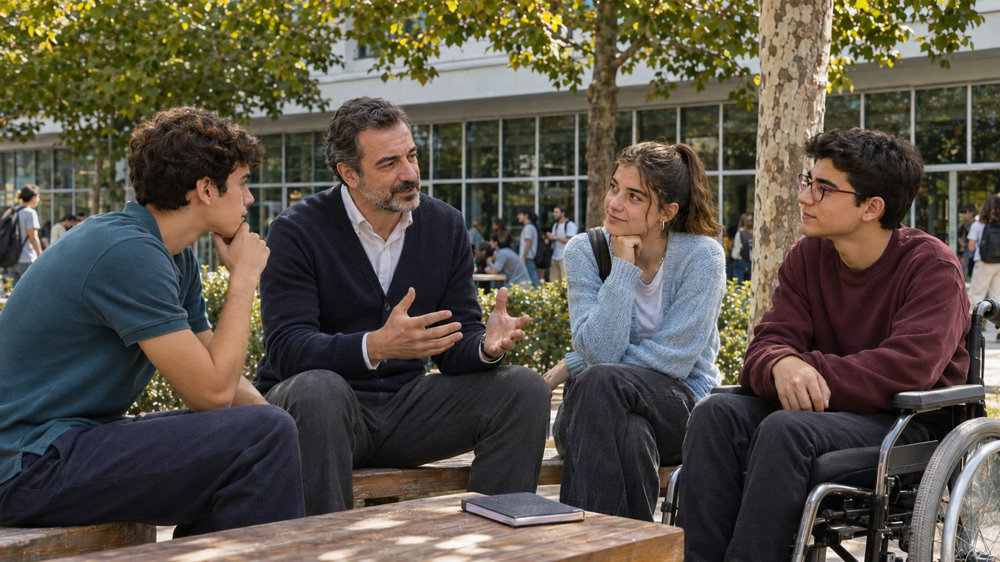

**Görsel:** Grubun düşünceli dinleyişi.

**Okutulacak metin:** fakat kendisi yaratılmayan bir zat gelmelidir.

**Okuyuş:** Nar ve fabrika benzetmesiyle kaynak görüşü açıklıyor.

**Arka plan:** Çok düşük düzeyde okul bahçesi ambiyansı; hafif yaprak hışırtısı ve uzaktan kuş sesi. Konuşmayı örtmesin.

## 48 · Murat Öğretmen · 5.5 sn

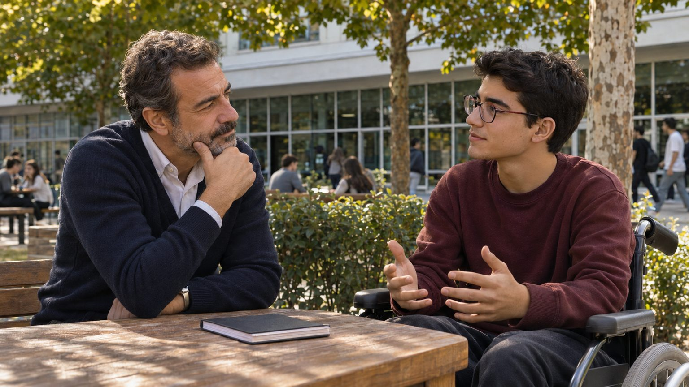

**Görsel:** Öğretmen ile Deniz'in ikili planı.

**Okutulacak metin:** O da yaratılmış olsa o zaman yaratıcı olamaz.

**Okuyuş:** Nar ve fabrika benzetmesiyle kaynak görüşü açıklıyor.

**Arka plan:** Çok düşük düzeyde okul bahçesi ambiyansı; hafif yaprak hışırtısı ve uzaktan kuş sesi. Konuşmayı örtmesin.

## 49 · Ali · 5.0 sn

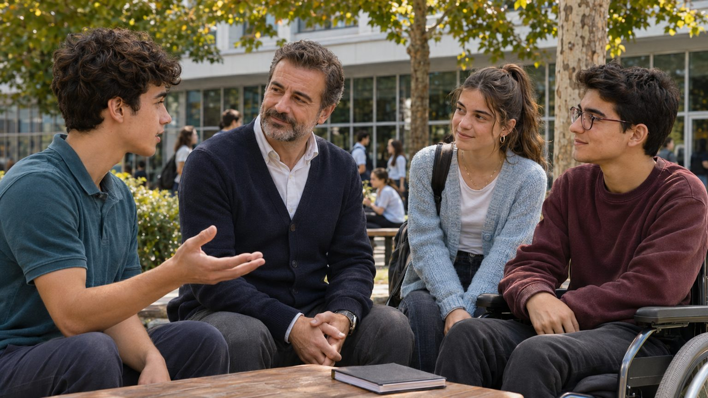

**Görsel:** Ali'nin devam sorusu.

**Okutulacak metin:** Onu kim yarattı? Başka bir Allah, onu başka...

**Okuyuş:** Kaynak metindeki soruyu ve devamındaki alıntıyı aktarıyor.

**Arka plan:** Çok düşük düzeyde okul bahçesi ambiyansı; hafif yaprak hışırtısı ve uzaktan kuş sesi. Konuşmayı örtmesin.

## 50 · Murat Öğretmen · 7.0 sn

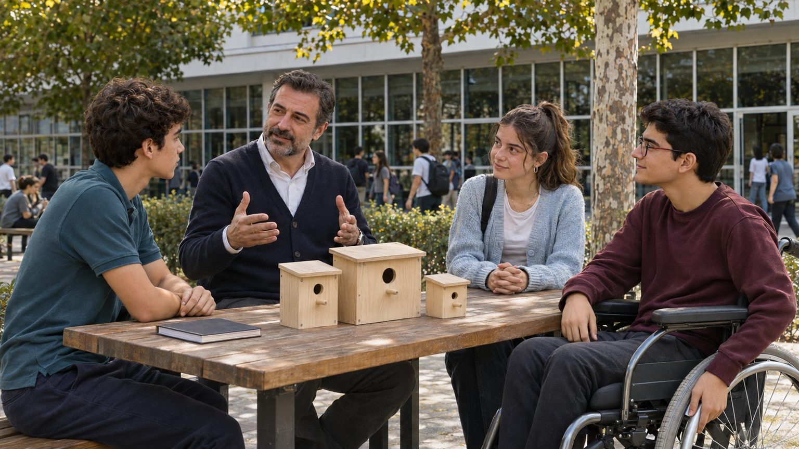

**Görsel:** Öğretmenin kutuların yanında açıklaması.

**Okutulacak metin:** İş sonsuza kadar uzar gider. Böyle bir şeyin olması da mümkün değildir.

**Okuyuş:** Kaynak metnin inanç yorumunu ve son sorularını aktarıyor.

**Arka plan:** Çok düşük düzeyde okul bahçesi ambiyansı; hafif yaprak hışırtısı ve uzaktan kuş sesi. Konuşmayı örtmesin.

## 51 · Murat Öğretmen · 5.0 sn

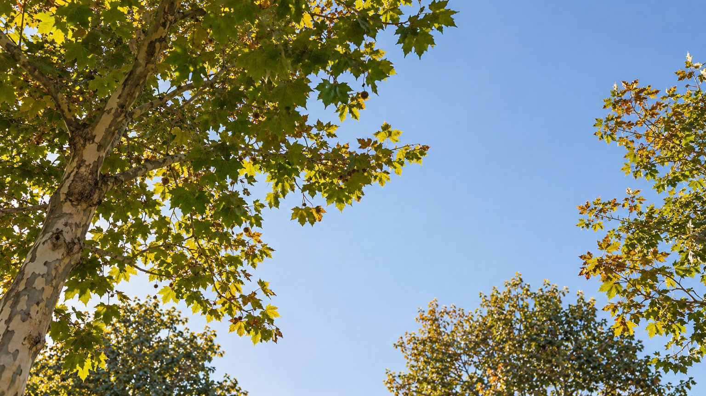

**Görsel:** Ağaçlardan gökyüzüne bakış.

**Okutulacak metin:** Hem böyle bir Allah olmazsa ne kainat olur,

**Okuyuş:** Kaynak metnin inanç yorumunu ve son sorularını aktarıyor. Ara planda aynı konuşmacının sesi kesilmeden, aynı tonda sürer.

**Arka plan:** Hafif bahçe rüzgârı, yaprak hışırtısı ve uzaktan kuşlar. Konuşmayı örtmesin.

## 52 · Murat Öğretmen · 4.5 sn

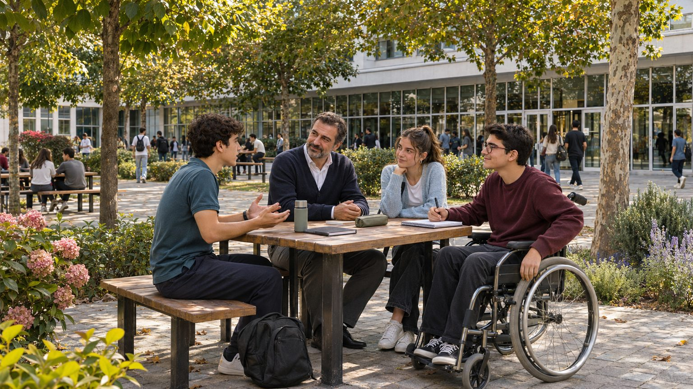

**Görsel:** Okul bahçesinde grubun geniş planı.

**Okutulacak metin:** ne içindekiler olur, ne de biz oluruz.

**Okuyuş:** Kaynak metnin inanç yorumunu ve son sorularını aktarıyor.

**Arka plan:** Çok düşük düzeyde okul bahçesi ambiyansı; hafif yaprak hışırtısı ve uzaktan kuş sesi. Konuşmayı örtmesin.

## 53 · Murat Öğretmen · 5.5 sn

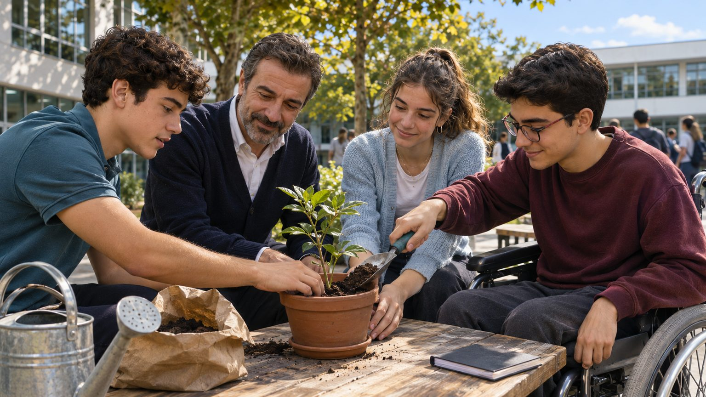

**Görsel:** Saksı toprağı, bitki ve doğal gün ışığı.

**Okutulacak metin:** Yani akılsız toprak, hava, güneş bir araya gelecek,

**Okuyuş:** Kaynak metnin inanç yorumunu ve son sorularını aktarıyor. Ara planda aynı konuşmacının sesi kesilmeden, aynı tonda sürer.

**Arka plan:** Hafif bahçe rüzgârı, yaprak hışırtısı ve uzaktan kuşlar. Konuşmayı örtmesin.

## 54 · Murat Öğretmen · 4 sn

**Görsel:** Ali ve Deniz, bitkilerin yanında.

**Okutulacak metin:** akıllı insanı yapacak.

**Okuyuş:** Kaynak metnin inanç yorumunu ve son sorularını aktarıyor. Ara planda aynı konuşmacının sesi kesilmeden, aynı tonda sürer.

**Arka plan:** Çok düşük düzeyde okul bahçesi ambiyansı; hafif yaprak hışırtısı ve uzaktan kuş sesi. Konuşmayı örtmesin.

## 55 · Murat Öğretmen · 6.5 sn

**Görsel:** Öğretmenin sakin vurgusu, yakın plan.

**Okutulacak metin:** Ha bu iddiaya inanmamız için aklımızı kaybetmemiz lazım.

**Okuyuş:** Kaynak metnin inanç yorumunu ve son sorularını aktarıyor.

**Arka plan:** Çok düşük düzeyde okul bahçesi ambiyansı; hafif yaprak hışırtısı ve uzaktan kuş sesi. Konuşmayı örtmesin.

## 56 · Murat Öğretmen · 7.5 sn

**Görsel:** Toprak, su damlaları, yapraklar ve güneş ışığı.

**Okutulacak metin:** Akılsız toprak, hava, su, güneş bir araya gelecek, akıl sahibi insanların

**Okuyuş:** Kaynak metnin inanç yorumunu ve son sorularını aktarıyor. Ara planda aynı konuşmacının sesi kesilmeden, aynı tonda sürer.

**Arka plan:** Hafif bahçe rüzgârı, yaprak hışırtısı ve uzaktan kuşlar. Konuşmayı örtmesin. Görünen damlalar için çok hafif su damlama sesi.

## 57 · Murat Öğretmen · 7.0 sn

**Görsel:** Masada meyve ve sebze sepeti; bahçe arka planı.

**Okutulacak metin:** yiyecekleri bitkileri, sebzeleri, meyveleri, hayvanları yapacak.

**Okuyuş:** Kaynak metnin inanç yorumunu ve son sorularını aktarıyor. Ara planda aynı konuşmacının sesi kesilmeden, aynı tonda sürer.

**Arka plan:** Hafif bahçe rüzgârı, yaprak hışırtısı ve uzaktan kuşlar. Konuşmayı örtmesin.

## 58 · Murat Öğretmen · 6.0 sn

**Görsel:** Öğretmenin kapanış cümlesi; Ece ve Ali dinler.

**Okutulacak metin:** Ha buna inanmamız için aklımızı kaybetmemiz lazım

**Okuyuş:** Kaynak metnin inanç yorumunu ve son sorularını aktarıyor.

**Arka plan:** Çok düşük düzeyde okul bahçesi ambiyansı; hafif yaprak hışırtısı ve uzaktan kuş sesi. Konuşmayı örtmesin.

## 59 · Sessiz kapanış · 4 sn

**Görsel:** Sessiz kapanış: dört karakter okul bahçesinde.

**Okutulacak metin:** Konuşma yok.

**Okuyuş:** Konuşma yok. Sakin okul bahçesi kapanışı.

**Arka plan:** Çok düşük düzeyde okul bahçesi ambiyansı; hafif yaprak hışırtısı ve uzaktan kuş sesi. Konuşmayı örtmesin.
